# Foydalanuvchi qo‘llanmasi

Sutkalik naryad platformasi 2-kurs sutkalik naryad ro‘yxatini tarix asosida, adolatli va avtomatik tuzadi.
- Ro‘yxatni **dastur** tuzadi. Kurs boshlig‘i uni tekshiradi, kerak bo‘lsa sabab ko‘rsatib tuzatadi va tasdiqlaydi.
- Kursant faqat o‘zining tasdiqlangan naryadlarini ko‘radi: navbatdagi naryadi (sana, joy, lavozim) va o‘z tarixi.

Bir sahifalik qisqa yo‘riqnoma (chop etib osib qo‘yish uchun): [`qollanma/qisqa-yoriqnoma.pdf`](qollanma/qisqa-yoriqnoma.pdf).

**Muhim tushunchalar**
- **Sutka** — shu sana 18:00 dan ertasi kuni 18:00 gacha. “13-oktabr sutkasi” = 13-oktabr 18:00 → 14-oktabr 18:00.
- **2-kurs haftasi** — yakshanba 18:00 dan keyingi yakshanba 18:00 gacha (7 sutka). Kurslar haftama-hafta almashadi, shuning uchun 2-kurs haftasini kurs boshlig‘i o‘zi ochadi.
- **Qoralama** — dastur tuzgan, hali tasdiqlanmagan ro‘yxat. Uni faqat admin ko‘radi.
- **Tasdiqlangan** — rasmiy ro‘yxat. Kursant undagi o‘z naryadini ko‘radi; to‘liq ro‘yxat va PDF — kurs boshlig‘ida.

---

## 1. Kurs boshlig‘i (admin) uchun

### 1.1. Kirish
Brauzerda platforma manzilini oching (masalan `https://naryad.example.uz`), login va parolni kiriting.
- 5 marta noto‘g‘ri parol kiritilsa, login 15 daqiqaga bloklanadi.
- Birinchi kirishda parolni almashtirish so‘ralishi mumkin.
- **Til:** kirish sahifasida va har sahifa sarlavhasida (tungi rejim tugmasi yonida) **UZ | RU | EN** tugmalari bor. Sukut bo‘yicha interfeys o‘zbekcha. Tanlangan til akkauntingizda saqlanadi: boshqa telefon yoki kompyuterdan kirganingizda ham shu til ochiladi. Rasmiy PDF naryad shakli va Excel hisoboti har doim o‘zbekcha. Kursantlarning ismlari va siz yozgan sabablar tarjima qilinmaydi.

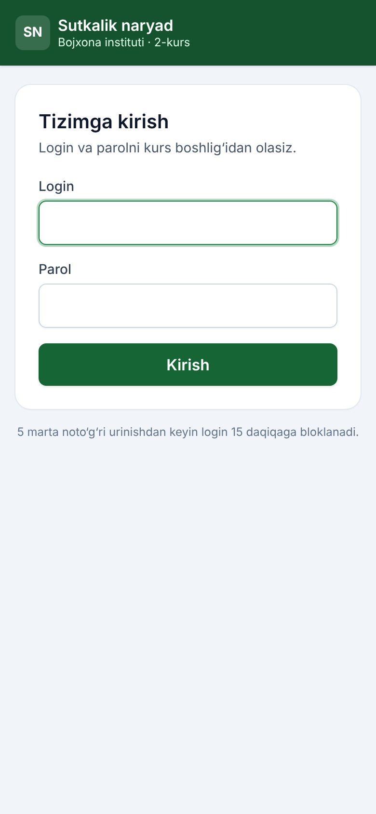

### 1.2. Bosh sahifa
Tepada institut binosi tushirilgan banner bor. Unda:
- jonli soat (Toshkent vaqti);
- joriy sutka: qachondan qachongacha, progress chizig‘i va smena almashishiga qolgan vaqt.

Holat kartochkalari har daqiqada o‘zi yangilanadi, sahifani qayta yuklash shart emas.

Sarlavhadagi quyosh/oy tugmasi rejimni almashtiradi: **avtomatik** (telefon/kompyuter sozlamasiga qarab) → **kunduzgi** → **tungi**. Tanlov shu qurilmada eslab qolinadi.

Bosh sahifada:
- **ertangi ro‘yxat banneri** (pastda batafsil);
- joriy 2-kurs haftasi va uning 7 sutkasi holati;
- **“Keyingi qadam”** tugmasi — hozir nima qilish kerakligini aytadi;
- har guruhning **adolat belgisi**.

**Ertangi ro‘yxat bir kun oldin tayyor bo‘lsin.** D sanadagi sutka D kuni 18:00 da boshlanadi. Uni kamida bir kun oldin — D−1 kuni 18:00 gacha — tasdiqlang, shunda kursantlar 24 soat oldin bilib, tayyorgarlik ko‘radi. Bosh sahifadagi banner:
- **sariq** — “Ertangi sutka (15-oktabr) hali tasdiqlanmagan. Muddat: bugun 18:00 gacha, 3 soat qoldi.” Yonida **Tuzish** yoki **Ochish** tugmasi;
- **qizil** — muddat o‘tdi, kursantlar hali bilmaydi;
- **yashil** — ertangi ro‘yxat tayyor, kursantlarga ko‘rinmoqda.

Banner faqat 2-kurs haftasi kunlarida va hafta boshlanishidan oldingi kuni (shanba) chiqadi. Muddatni boshqaruv panelidagi **Sozlamalar → Tasdiqlash muddati (soat)** da o‘zgartirish mumkin (standart 24). Keyingi sutka avvalgidek faqat oldingisi tasdiqlangandan keyin tuziladi: bugungisini tasdiqlagan zahoti ertangisini tuzish mumkin.

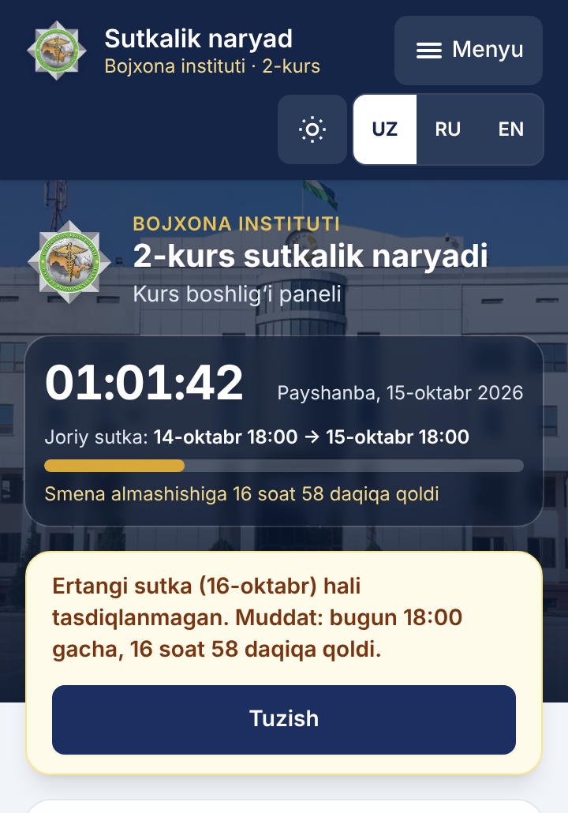

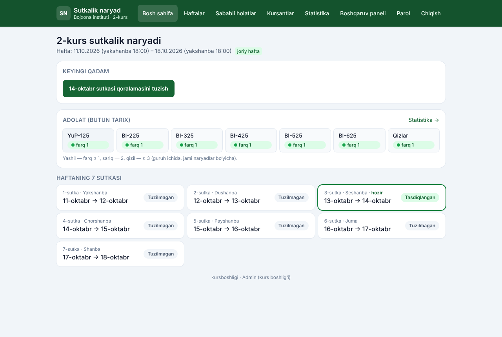

### 1.3. Haftani ochish
**Haftalar** → yakshanba sanasini tanlang. Pastda shu haftaning 7 sutkasi ko‘rinadi → **Haftani ochish**.
Faqat yakshanba tanlanadi; haftalar bir-biriga to‘g‘ri kelmasligi tekshiriladi.

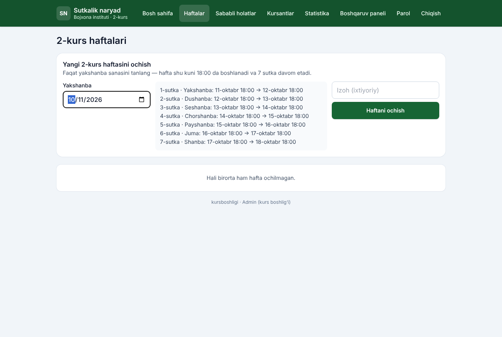

### 1.4. Sutkani tuzish
Haftalardan sutkani bosing → **Tuzish**.
- Dastur ro‘yxatni tarix asosida tuzadi:
  - guruhlar joylar bo‘yicha aylanadi (Markaz → 1-NO‘J → 2-NO‘J → 1-Yotoqxona → O‘quv binosi → Patrul);
  - guruh ichida eng kam navbatda turganlar tanlanadi.
- Sutkalar ketma-ket tuziladi: avvalgisi tasdiqlanmasa, keyingisini tuzib bo‘lmaydi.
- Kecha navbatda turgan yoki sababli yo‘q (kasal, ta’til) kursant hech qachon qo‘yilmaydi. O‘rin yetmasa, bo‘sh qoladi va qizil ogohlantirish chiqadi.

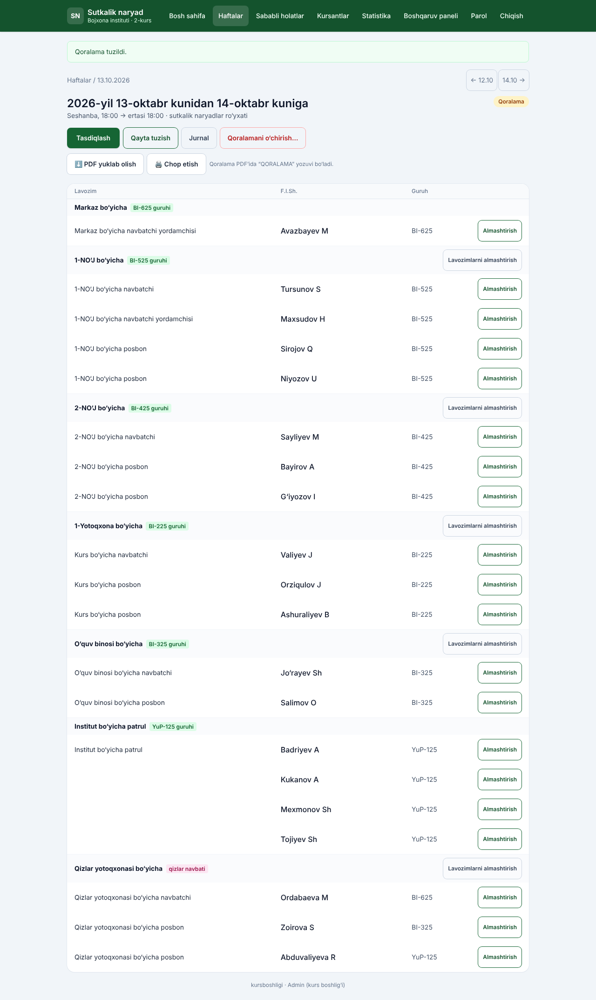

### 1.5. Almashtirish (qo‘lda tuzatish)
Kerakli qatordagi **Almashtirish** tugmasini bosing.
- Oynada nomzodlar algoritm tartibida chiqadi: eng munosibi birinchi, yonida uning hisob-kitobi.
- Taqiqlangan nomzodlar (kecha navbatda bo‘lgan, sababli yo‘q, bugun boshqa joyda turgan) tanlab bo‘lmaydi.
- **Sabab majburiy:** kasal / ta’til / sababli / boshqa.
  - “Kasal” yoki “Ta’til” tanlansa, olib tashlangan kursantga shu sutka uchun sababli holat avtomatik yoziladi.
- Har bir o‘zgarish **jurnalga** yoziladi: kim, qachon, nima, nega.

| Almashtirish oynasi | Natija |
|---|---|
| 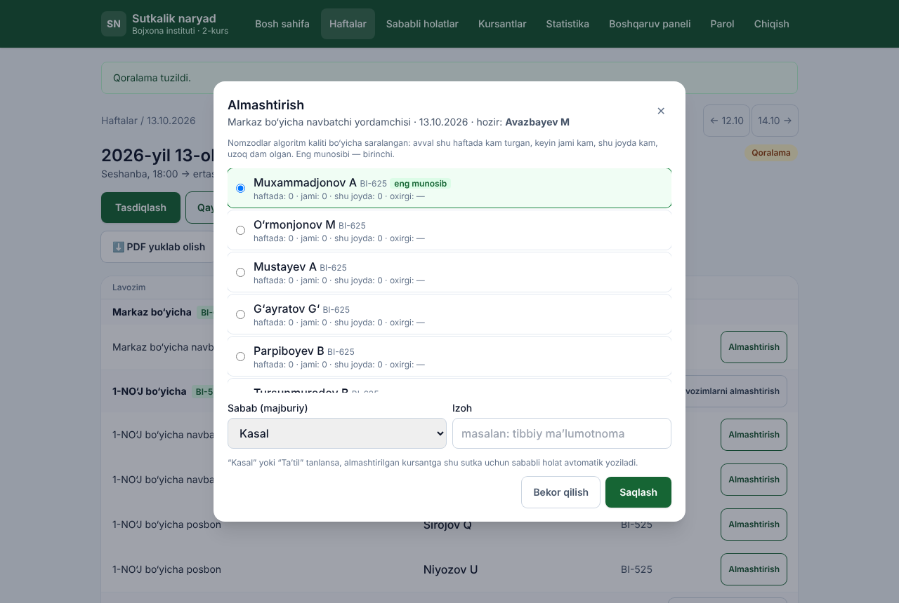 | 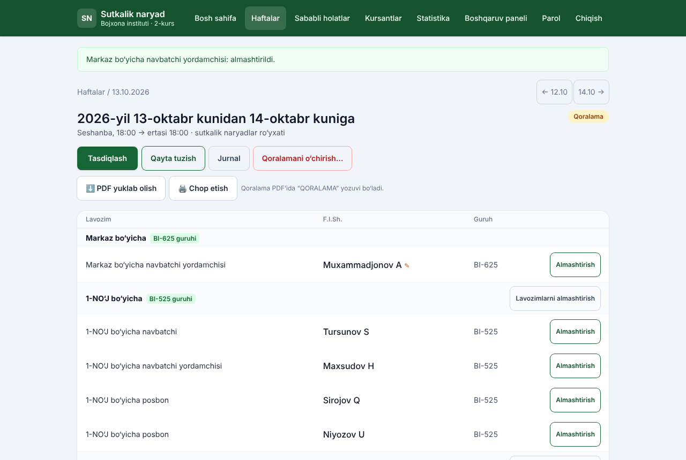 |

Qo‘lda qo‘yilgan kursant yonida ✎ belgisi turadi.

Bitta joy ichida ikki kursantning lavozimini almashtirish uchun **Lavozimlarni almashtirish** tugmasi bor.

Boshqa amallar:
- **Qayta tuzish** — qo‘lda kiritilgan o‘zgarishlar o‘chadi, oldin so‘raladi.
- **Qoralamani o‘chirish** — faqat eng oxirgi qoralama, sabab bilan.

### 1.6. Tasdiqlash
Ogohlantirishlar qolmagach (bo‘sh o‘rin, faol emas yoki sababli yo‘q kursant), **Tasdiqlash** tugmasi faol bo‘ladi.
- Tasdiqlangan ro‘yxatni o‘zgartirib bo‘lmaydi.
- Kerak bo‘lsa, **Tasdiqni bekor qilish…** (sabab majburiy) bilan qayta qoralamaga qaytariladi. Keyingi sutka allaqachon tuzilgan bo‘lsa, avval o‘shani bekor qilish kerak.

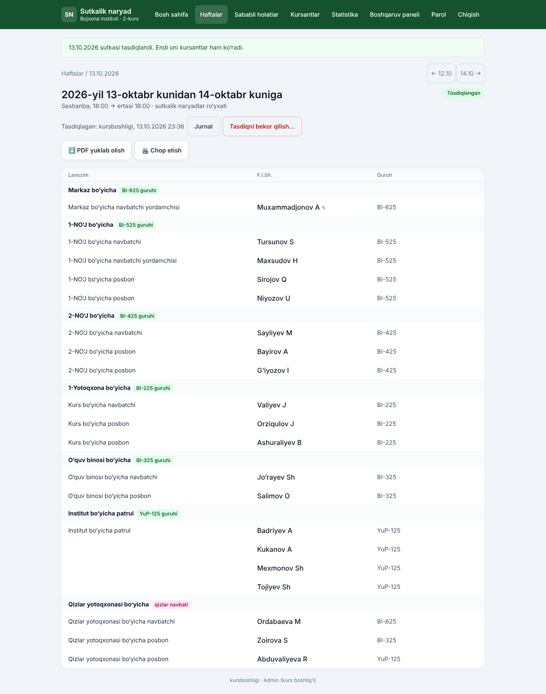

### 1.7. PDF va chop etish
- **PDF yuklab olish** — rasmiy shakldagi A4 ro‘yxat (`naryad_2026-10-13.pdf`).
- **Chop etish** — PDF ochiladi va chop etish oynasi avtomatik chiqadi. Telefonda **“PDF’ni alohida ochish”** havolasidan foydalaning.
- **Hafta PDF** (Haftalar sahifasida) — 7 sutka, har biri alohida sahifada.
- Qoralama PDF’ida “QORALAMA” yozuvi bo‘ladi.

### 1.8. Jurnal
Sutka sahifasidagi **Jurnal** tugmasi shu sutkadagi barcha amallarni vaqt tartibida ko‘rsatadi: tuzish, almashtirish, tasdiqlash, bekor qilish.

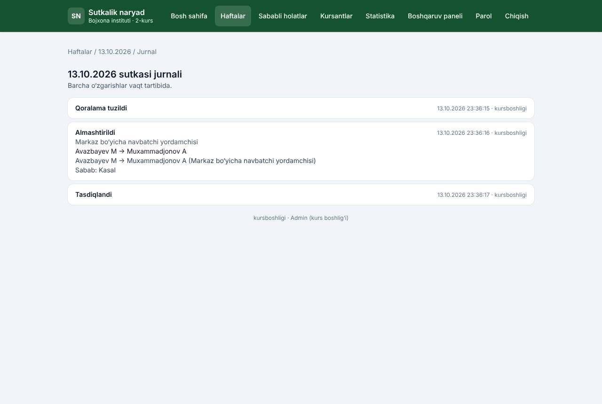

### 1.9. Sababli holatlar (kasal, ta’til)
**Sababli holatlar** sahifasida kursant, sabab va sanalar (dan–gacha) kiritiladi. Shu kunlarda dastur uni naryadga qo‘ymaydi.
- Tugash sanasini o‘zgartirish mumkin (masalan, erta tuzalsa).
- Hali boshlanmagan yozuvni o‘chirish mumkin.

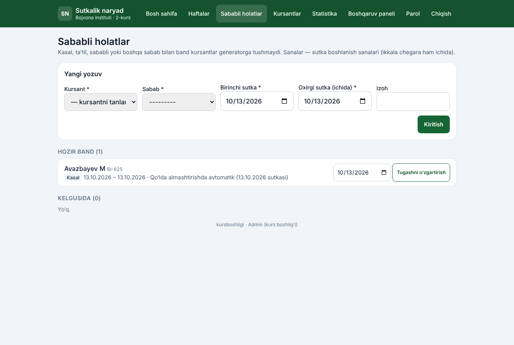

### 1.10. Kursantlarni boshqarish
**Kursantlar** sahifasida:
- guruhlar bo‘yicha sonlar, familiya bo‘yicha qidiruv, filtrlar;
- **Kursant qo‘shish**, tahrirlash. Qisqa ism (`Familiya I`) avtomatik yasaladi;
- **Faolsizlantirish** (sabab bilan): kursant o‘chirilmaydi, tarixi qoladi, lekin naryadga tushmaydi va tizimga kira olmaydi;
- **Excel import:** avval ko‘rib chiqish, keyin tasdiqlash. Shablon sahifada; fayl ≤ 2 MB, faqat `.xlsx`.

- **Naryaddan ozod qilish** (komandirlar, kurs starshinasi, pisar, kaptyorchik): kursant kartochkasida **Naryaddan ozod qilish…** — lavozim va sabab majburiy.
  - Kursant faol qoladi va tizimga kiradi, faqat sutkalik naryadga qo‘yilmaydi.
  - Ro‘yxatda “ozod” belgisi bor, filtr: *Naryaddan ozod* / *Naryadga chiqadi*.
  - Lavozimdan bo‘shasa — **Naryadga qaytarish…**. Algoritm uni hisob bo‘yicha o‘zi oldinga qo‘yadi.
- Guruhlar jadvalidagi **“Naryadga chiqadi”** ustuni — ozodlarsiz o‘g‘il bolalar soni (jami 78).

Kursant kartochkasida: naryadlar tarixi, joylar va lavozimlar bo‘yicha sonlar, guruh o‘rtachasi bilan solishtirish, o‘zgarishlar jurnali.

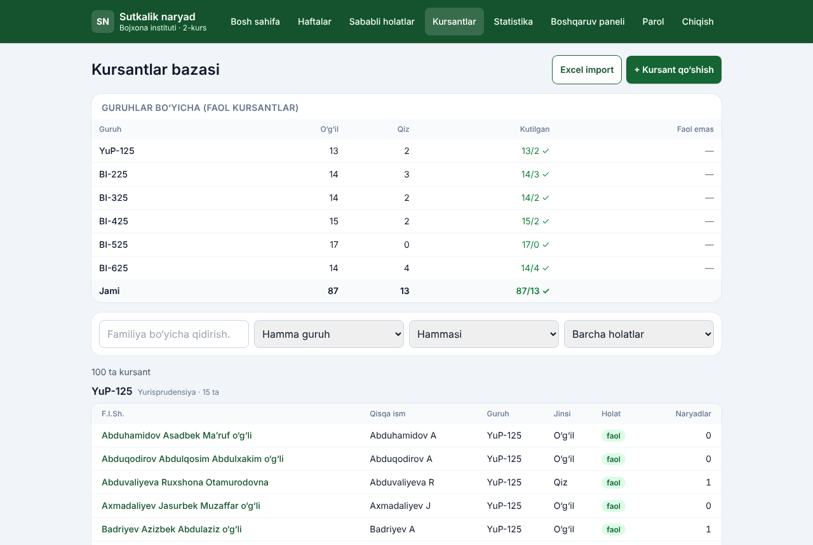

### 1.10a. Zalyotchiklar (navbatdan tashqari naryad)
Menyudagi **Zalyotchiklar** bo‘limi — tanbeh olgan kursantlar uchun navbatdan tashqari (jazo) naryadlari.

**Kiritish.** Formada quyidagilarni to‘ldiring:
- kursant;
- sabab turi: ichki tartib-qoidalarni buzish, naryadda uxlab qolish yoki boshqa;
- izoh (majburiy);
- buyruq/tanbeh sanasi;
- jazo naryadlari soni (1–10).

Kursantda faol zalyot bo‘lsa, yangi son unga qo‘shiladi. Faqat o‘g‘il, faol va naryaddan ozod bo‘lmagan kursantni zalyotchik qilish mumkin.

**Qanday qo‘yiladi.** Dastur sutkani tuzganda faol zalyotchikni **1-NO‘J** yoki **1-Yotoqxonaga** posbon o‘rniga qo‘yadi:
- uning guruhi qayerda turishi muhim emas;
- shu joy guruhi bitta kam kishi beradi;
- bir joyga sutkasiga 1 ta zalyotchik qo‘yiladi (Sozlamalarda 2 qilish mumkin);
- tanbeh sanasi eskisi birinchi;
- joy navbatma-navbat almashadi.

Kecha turgan yoki sababli holatdagi zalyotchik qo‘yilmaydi — sutka sahifasida sariq eslatma chiqadi.

**Sutka sahifasi.** Jazo o‘rni **Zalyot** belgisi bilan ko‘rinadi. Rasmiy PDF’da bu belgi yo‘q: zalyotchik oddiy qator bo‘lib chiqadi.

**Hisob.** Jazo naryadi sutka **tasdiqlanganda** “o‘tildi” deb sanaladi. Soni tugagach, zalyot o‘zi “bajarildi” bo‘ladi. Tasdiqni bekor qilsangiz, hisob ham qaytadi. Jazo naryadlari adolat hisobiga kirmaydi: zalyotchikning oddiy navbati kamaymaydi.

**Bekor qilish.** Zalyotni sabab yozib bekor qilish mumkin. Hamma amallar jurnalga yoziladi.
- Bekor qilingan zalyotning kursanti ochiq qoralamada jazo o‘rnida qolsa, sutka tasdiqlanmaydi: uni almashtiring yoki sutkani qayta tuzing.
- Faol zalyoti bor kursantni naryaddan ozod qilib bo‘lmaydi: avval zalyot bajarilishi yoki bekor qilinishi kerak.

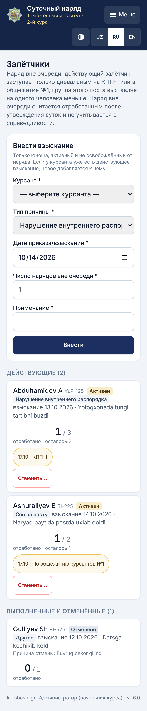

### 1.11. Statistika va ogohlantirishlar
**Statistika** sahifasi hisobni faqat tasdiqlangan sutkalar bo‘yicha qiladi.

**Davr:** butun tarix, sanadan sanagacha yoki bitta 2-kurs haftasi.

**Kursant × joy jadvali** (guruh tanlanadi):
- rang qanchalik to‘q bo‘lsa, shuncha ko‘p;
- telefonda jadval yonga suriladi, ism ustuni qotib turadi.

**Adolat belgisi** — har guruh ichida jami naryadlar farqi:

| Belgi | Farq | Ma’nosi |
|---|---|---|
| 🟢 yashil | ≤ 1 | adolatli |
| 🟡 sariq | 2 | diqqat |
| 🔴 qizil | ≥ 3 | adolatsiz — sababini tekshiring |

**Boshqa bo‘limlar:**
- **Ketma-ket bir joy** — kimning ketma-ket ikki naryadi bir joyga tushgani.
- **Qizlar uchun** — ketma-ket ikki marta navbatchi bo‘lganlar.
- **Guruhlar kesimi** — har guruh har joyni necha marta bergani. Kichik guruhda bir kursantga ko‘proq naryad to‘g‘ri keladi — bu qabul qilingan qoida.
- **Qo‘lda tuzatishlar nazorati:**
  - almashtirishlar sabab va kim tomonidan qilingani bo‘yicha;
  - har kursant necha marta qo‘lda qo‘yilgan va olib tashlangan;
  - **qizil ro‘yxat** — guruh o‘rtachasidan sezilarli ko‘p (≥ 2 marta va ≥ 2 baravar) qo‘lda qo‘yilganlar. Bu qog‘ozdagi adolatsizlik qaytmasligi uchun.
- **Excel’ga yuklab olish** — barcha jadvallar bitta faylda, har biri alohida varaqda.

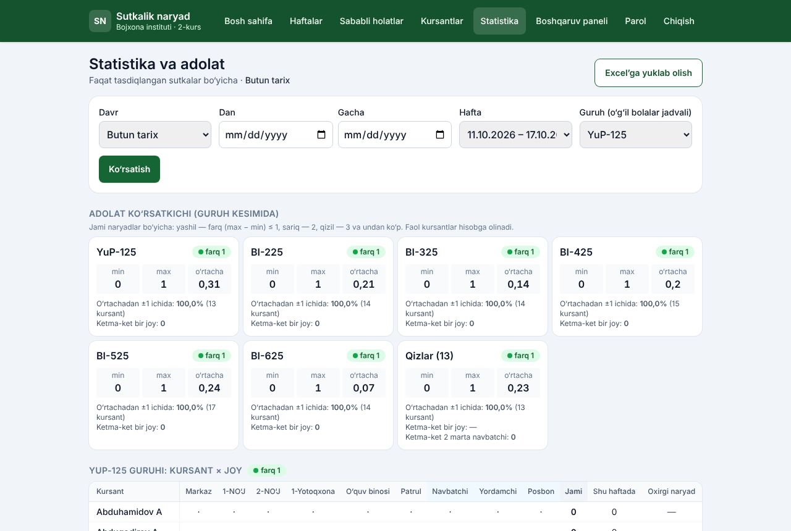

### 1.12. Telefonda
Hamma sahifa telefonga moslangan: menyu o‘ng yuqoridagi **Menyu** tugmasida.

| Sutka (telefon) | Menyu |
|---|---|
| 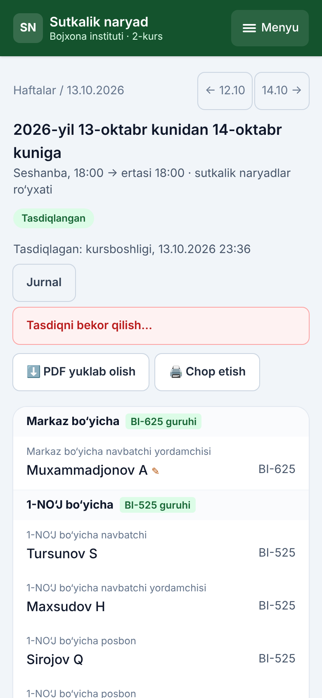 | 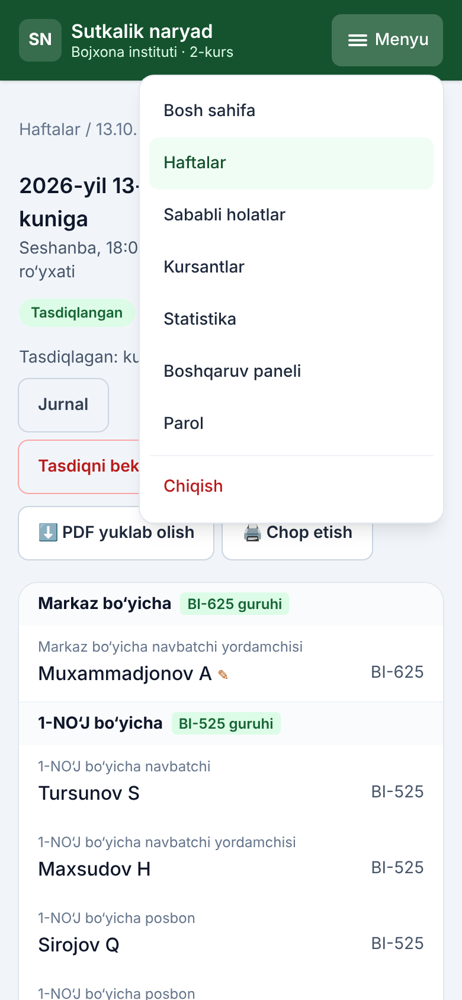 |

### 1.13. Boshqaruv paneli
**Boshqaruv paneli** (`/admin/`) — kamdan-kam kerak bo‘ladigan sozlamalar uchun:
- imzo (unvon, F.I.Sh.), “Tasdiqlayman” bloki;
- **tasdiqlash muddati** (soat, standart 24);
- **tayyorgarlik eslatmalari** — har joy uchun qisqa matn uch tilda (masalan: “17:30 da yo‘riqnomaga keling, forma — kundalik”). Kursant uni o‘z naryadi kartochkasida ko‘radi. Joriy tildagisi bo‘sh bo‘lsa o‘zbekchasi chiqadi, hammasi bo‘sh bo‘lsa — hech narsa;
- boshlang‘ich guruh → joy taqsimoti;
- foydalanuvchilar va login cheklovlari.

Unga faqat admin kiradi.

---

## 2. Kursant uchun

### 2.1. Kirish va parol
- **Login:** `familiya.ism`, masalan `aliyev.vali`.
- Vaqtinchalik parolni kurs boshlig‘i beradi.
- Interfeys tilini sarlavhadagi **UZ | RU | EN** tugmalari bilan tanlash mumkin; tanlov akkauntingizda saqlanadi.
- Birinchi kirishda parolni almashtirish shart. Yangi parol kamida 8 belgi bo‘lsin, faqat raqamlardan iborat yoki oddiy (`12345678`, `parol123`) bo‘lmasin.
- Keyin parolni **Menyu → Parol** orqali istalgan vaqtda almashtirish mumkin.

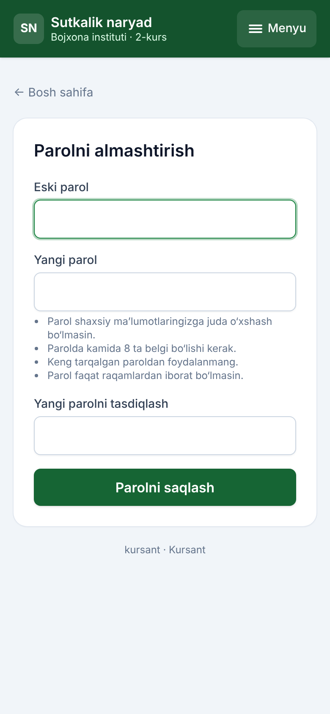

### 2.2. Mening naryadlarim
Bosh sahifada katta kartochka **“Mening navbatdagi naryadim”**:
- sana va vaqt: “15-oktabr, chorshanba 18:00 → 16-oktabr 18:00”;
- **joy** (masalan, “1-NO‘J bo‘yicha”) va **lavozim** (navbatchi, navbatchi yordamchisi yoki posbon), guruhingiz;
- jonli hisoblagich: “Naryadga 21 soat 14 daqiqa qoldi”, naryad davomida — “Hozir naryaddasiz, smena almashishiga … qoldi”;
- **tayyorgarlik eslatmasi** (kurs boshlig‘i kiritgan bo‘lsa).

Naryadingiz bo‘lmasa: “Yaqin kunlarda tasdiqlangan naryadingiz yo‘q”. Navbatdan tashqari (jazo) naryadi bo‘lsa, kartochkada **“Navbatdan tashqari naryad”** belgisi va “Jazo naryadlari: 3 tadan 1 tasi o‘tildi” yozuvi chiqadi. Kartochka ostida shu haftadagi va jami naryadlar soni hamda **Mening tarixim** havolasi.

Faqat **tasdiqlangan** naryad ko‘rinadi, qoralama hech qachon ko‘rinmaydi. Kurs boshlig‘i tasdiqni bekor qilib sizni almashtirsa, kartochkada **“Naryadingiz bekor qilindi”** chiqadi.

**Mening tarixim** — barcha naryadlaringiz, joylar va lavozimlar bo‘yicha sonlar, hamda guruh o‘rtachasi bilan solishtirish. Boshqa kursantlarning ismlari ko‘rinmaydi.

| Bosh sahifa | Mening tarixim |
|---|---|
| 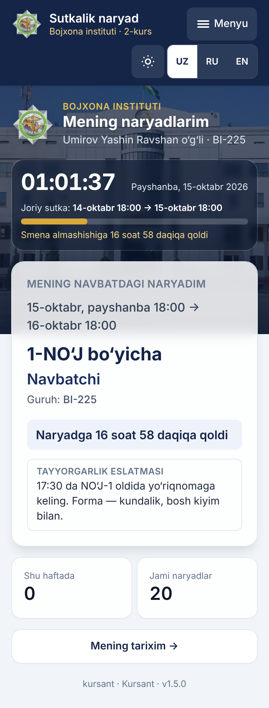 | 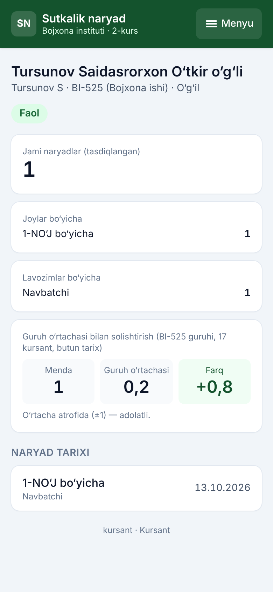 |

### 2.3. Nimani ko‘rmaysiz
Kursant faqat **o‘zining** naryadlarini ko‘radi (1.5.0 dan). Boshqa kursantlarning ro‘yxati, sutka sahifalari, PDF, statistika va boshqa kursantning kartochkasi ochilmaydi — “Ruxsat yo‘q” xabari chiqadi.

---

## 3. Tez-tez beriladigan savollar

**Nega meni (yoki uni) qo‘ydi?**
Dastur guruh ichida avval shu haftada kam turganlarni tanlaydi. Keyin quyidagilarga qaraydi:
1. jami naryadlar kam bo‘lgan;
2. o‘tgan safar boshqa joyda turgan;
3. shu joyda kam turgan;
4. uzoqroq dam olgan.

Batafsil: [`02-algoritm.md`](02-algoritm.md).

**Kasal bo‘lib qoldim.** Kurs boshlig‘iga ayting: u sababli holat kiritadi va qoralamada sizni almashtiradi.

**Parolimni unutdim.** Kurs boshlig‘i boshqaruv panelida yangi vaqtinchalik parol beradi.

**Nega guruhimizga ko‘proq naryad tushadi?** Joylar guruhlar o‘rtasida teng aylanadi. Kichik guruhda kursant kam bo‘lgani uchun har biriga ko‘proq to‘g‘ri keladi. Adolat guruh **ichida** o‘lchanadi.
